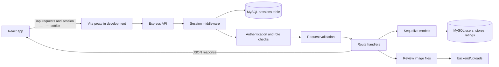
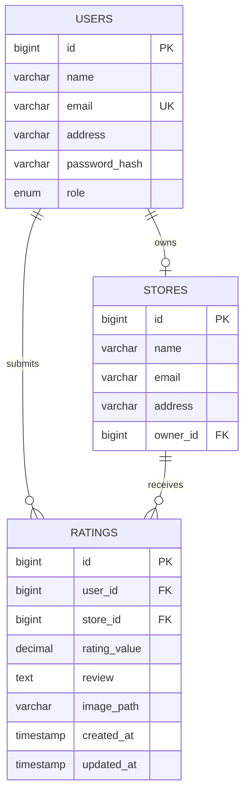
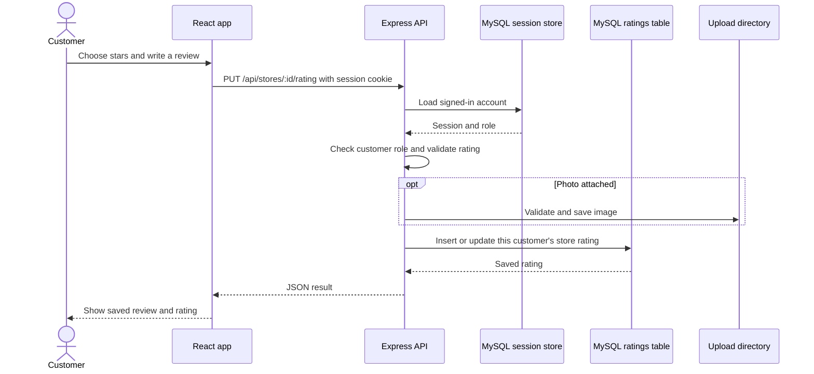

# Backend

The API is an Express application backed by MySQL through Sequelize. It owns authentication, role checks, validation, store and rating operations, and review image uploads.

## Request architecture



The browser sends same-origin `/api` requests during development. Vite forwards them to Express, and the signed session cookie identifies the account. Express checks the role before protected handlers run. The handlers validate input, read or write through Sequelize, then return JSON. Review images are kept on disk and served under `/uploads`.

## Data model



`users` holds all account roles. `stores.owner_id` is nullable and unique, so a store can be unassigned and each owner can have at most one store. A unique `(user_id, store_id)` pair allows one editable review per customer and store. Ratings use half-star steps from 0.5 to 5. The session table is managed by `connect-session-sequelize` and is separate from the business tables.

The schema is in [`sql/schema.sql`](sql/schema.sql). More relationship notes are in [`../docs/database.md`](../docs/database.md).

## Rating request flow



The unique user/store key means the same request updates a customer's previous rating rather than creating a second one. If saving fails after a photo upload, the API removes the unused file.

## Source layout

```text
backend/
├── src/
│   ├── server.js       # Express setup, API routes, startup, and migrations
│   ├── db.js           # MySQL connection
│   ├── models.js       # User, store, and rating models and relationships
│   └── validation.js   # Shared request validation rules
├── sql/schema.sql      # Initial database and table definitions
├── scripts/            # Optional sample account seeder
├── uploads/            # Created at runtime for review photos; ignored by Git
└── .env.example        # Local configuration template
```

## Local setup

From the repository root, copy the example environment file and set your MySQL password:

```powershell
Copy-Item backend\.env.example backend\.env
notepad backend\.env
```

The defaults connect to `127.0.0.1:3306` and database `store_rating`. Create the database in MySQL Workbench or run `sql/schema.sql` there. Install dependencies from the root with `npm.cmd run install:all`.

Start the API and frontend together from the root with `npm.cmd run dev`. To run the API alone, open PowerShell in `backend/` and run:

```powershell
npm.cmd run dev
```

The API listens at `http://localhost:4000`. `GET /api/health` reports whether the API can connect to MySQL.

## Configuration

| Variable | Default | Purpose |
| --- | --- | --- |
| `PORT` | `4000` | Express port |
| `CLIENT_URL` | `http://localhost:5173` | Allowed browser origin for credentialed requests |
| `DB_HOST` | `127.0.0.1` | MySQL host |
| `DB_PORT` | `3306` | MySQL port |
| `DB_NAME` | `store_rating` | Database name |
| `DB_USER` | `root` | MySQL account |
| `DB_PASSWORD` | empty | MySQL password; set this for your installation |
| `SESSION_SECRET` | generated in development | Session signing secret; production requires a unique value of at least 32 characters |
| `ADMIN_EMAIL` | `storeappadmin@gmail.com` | Email for the initial administrator |
| `ADMIN_PASSWORD` | `Appadmin@123` | Password for the initial administrator |

The API creates application tables, the MySQL-backed session table, and the initial administrator at startup. The administrator is only inserted if the configured email does not already exist. Passwords are hashed with bcrypt. Session cookies are HTTP-only and expire after 24 hours. Change the default admin password and set `SESSION_SECRET` before deploying beyond local evaluation.

Never commit `backend/.env` or files in `backend/uploads/`; both are excluded by the root `.gitignore`.

## API routes

Every endpoint is under `/api`. Session authentication and role checks are applied on the server.

| Method | Route | Access | Purpose |
| --- | --- | --- | --- |
| `GET` | `/health` | Public | Check database connectivity |
| `POST` | `/auth/register` | Public | Register a normal user |
| `POST` | `/auth/login` | Public | Sign in |
| `GET` | `/auth/me` | Signed in | Get the current account |
| `POST` | `/auth/logout` | Signed in | End the session |
| `PUT` | `/auth/password` | Signed in | Change password |
| `GET` | `/stores` | Normal user | Search and sort stores with rating details |
| `PUT` | `/stores/:id/rating` | Normal user | Create or update a rating, review, and optional image |
| `GET` | `/admin/summary` | Admin | Get user, store, and rating totals |
| `GET`, `POST` | `/admin/users` | Admin | List or create accounts |
| `PUT`, `DELETE` | `/admin/users/:id` | Admin | Edit or delete an account |
| `GET`, `POST` | `/admin/stores` | Admin | List or create stores |
| `PUT`, `DELETE` | `/admin/stores/:id` | Admin | Edit or delete a store |
| `GET` | `/owner/dashboard` | Store owner | Get store average and submitted reviews |

## Sample data

Run `npm.cmd run seed:samples` from the repository root to create 40 customers, 20 owners, and one store for each owner. All sample accounts use `Sample@123`. The seeder is safe to rerun; it adds missing sample accounts without duplicating existing ones.
